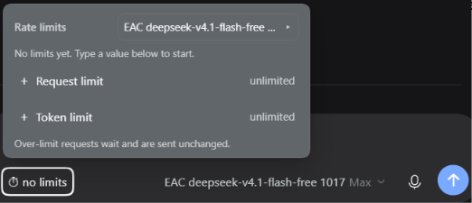

# dsh-llm-model-rate-limit

Per-model rate limits for DeepSeek Harness requests and tokens — keep your agents under provider limits without HTTP 429s stopping them.

## What it does

Each model (`provider/model`) gets its own budget over four rolling windows — second, minute, hour, day — for requests and for tokens. When a model reaches a limit, the agent doesn't stop or error out: the request waits in a FIFO queue spending zero tokens, a single timer wakes it the instant the window frees, and the unchanged request is sent automatically. Provider `429`/`503` responses are handled with `Retry-After` or jittered backoff and never surface as fatal.

| | |
|---|---|
|  |  |

## Where it lives

The composer toolbar shows a small `⏱` trigger immediately before the model selector. Click it to open the limits menu of the session's current model. Expand **Request limit** or **Token limit** with `+`/`−` and type per-second / per-minute / per-hour / per-day values. `0`, an empty field, or `unlimited` means no limit; token fields accept `k`/`m` suffixes (e.g. `500k`). The field commits on Enter or blur.

While the model waits for capacity the trigger shows `⏸` plus a countdown (`4 s · 11 111/s`). Changes apply immediately — no restart.

## Per-model

Limits belong to one model only. The header includes a model picker listing every model that has a policy plus every model the session catalog advertises, so you can set limits for models other than the currently selected one.

## Cascade

Bounded windows must stay non-decreasing: `second ≤ minute ≤ hour ≤ day`. Raising a smaller window lifts bounded windows below it; lowering a larger window pulls bounded smaller windows above it. Setting a field to unlimited never moves others.

## Idle mode

Over-limit requests queue in arrival order, consume no tokens, and arm exactly one timer for the moment capacity frees. The same unchanged request resumes automatically — no user action. A request larger than the whole window waits for an empty window and is flagged in the menu and log. Cancelling cleans up timers; tools and non-model work are unaffected.

## Persistence & config

Limits live in the profile's `cordis.patch.yml` under id `model-rate-limit`; counters are stored atomically in `$DSH_PROFILE_DIR/.dsh/model-rate-limit/state.json` with one row per live second. A model absent from the config is unlimited and costs one map lookup — no timer, no counter write, no clock read.

## Install

Install bundle `dsh-llm-model-rate-limit` from the Plugin Manager (point it at this repo). A profile restart is required to load the client bundle; the Plugin Manager shows *Installed — restart to apply* until then.

## Verification

130 tests (cascade, window boundaries, FIFO/idle queue, 429 recovery, persistence and clock jumps, HTTP surface, mock provider), lint and typecheck clean.

## Limitations

- Limits are process-local; several DSH processes on one provider account don't share a budget.
- Counters are rolling-window, not a durable ledger — a crash between flushes loses up to one flush interval of accounting.
- Aliased model ids are treated as independent models.
